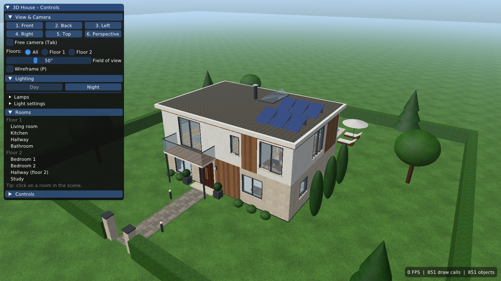

# 3D Къща – интерактивна архитектурна сцена с осветление

Курсов проект по **Компютърна графика (BCSE51)**, ТУ – София.

Приложението визуализира двуетажна модерна вила с обзавеждане, тераса, басейн и двор. Сградата е изградена изцяло от геометрични примитиви. Сцената може да се разглежда от различни ъгли и по етажи. При клик върху стая камерата отива при нея. Поддържат се ден/нощ, включване на лампи и смяна на материали.



## Функционалности

| Функционалност | Реализация |
|---|---|
| Двуетажна вила от примитиви | `HouseBuilder` – куб, цилиндър, конус, сфера, призма; 8 стаи, висящо стълбище, балкон, плосък покрив с капандура и фотоволтаици |
| Луксозни детайли | Травертин, мрамор, дървена обшивка, камина, полилей, кухненски остров, свободностояща вана, пергола, басейн |
| Разглеждане от няколко ъгъла | 6 готови изгледа (клавиши 1–6) с плавен преход на камерата |
| Свободно движение на камерата | Orbit (мишка) и Free (WASD + мишка, `Tab`) |
| Клик върху стая → камерата отива там | Избор чрез цветово кодиране (color-ID picking) в отделен framebuffer |
| Изглед по етажи | „Всички / Само етаж 1 / Само етаж 2“ (F1/F2/F3): скриват се покривът и горният етаж |
| Ден / нощ | Плавен преход; нощем **всички лампи се включват автоматично**, прозорците и басейнът светят |
| Лампи | 15 точкови светлини: 8 стайни, камина (трепти), аплици, градински лампи, пергола, басейн – всяка се включва поотделно |
| Промяна на цвят и материал | Панел (на английски): цвят, текстура, повторение, отражение, гланц – за стени, подове, покрив, фасада и двор. Обзавеждането (мебели и лампи) е с фиксиран материал |
| Информация за обект | Име, тип, стая, етаж, позиция, размери, брой триъгълници |
| Анимация | Двукрилата входна врата се отваря с ротация около пантите (`O`); водата в басейна „тече“; огънят трепти |
| Снимки на екрана | `F12` → папка `screenshots/` (за документацията) |

## Графични техники

- **Трансформации** – транслация, ротация и мащабиране: `Transform::matrix()`, M = T · R · T(pivot) · S.
- **Матрици** – моделна, изгледна (`lookAt`) и перспективна проекция: `Camera`.
- **Blinn–Phong осветление** – дифузна, огледална (полувектор H) и околна компонента: `shaders/blinn_phong.frag`.
  - 1 насочена светлина (слънце или луна);
  - до 16 точкови светлини със затихване 1/(1 + k₁d + k₂d²);
  - полусферична околна светлина.
- **Зони на светлините** – всяка лампа осветява само своята стая. Без тази мярка светлината би минавала през стените, защото сцената няма сенки.
- **Текстуриране** – текстурите (травертин, мрамор, паркет, дървена обшивка, вода, трева, камък, плат и др.) се генерират процедурно (fBm шум).
  - Използва се кутийна UV проекция в метри, така че текстурата не се разтяга при мащабиране.
  - Анимирана текстура: UV координатите на водата се отместват във времето (`uUVOffset`).
  - Ако в `assets/textures/` има `marble.png`, `parquet.png` и т.н., вместо генерираната текстура се зарежда файлът.
- **Избор чрез цветово кодиране** – индексът на всеки обект се кодира в RGB и сцената се рисува в невидим FBO. После се чете пикселът под курсора: `PickingBuffer`, `Renderer::pick`.
- **Прозрачност** – стъклата се рисуват след непрозрачните обекти със смесване (alpha blending) и без запис в буфера за дълбочина.
- **Процедурно небе** – цял екран с един триъгълник, градиент, диск на слънцето/луната и звезди: `shaders/sky.frag`.
- **Собствено светене (emissive)** – крушки, абажури, огънят и водата светят, когато свързаната светлина е включена.
- **Мъгла по разстоянието** – далечните обекти се сливат с цвета на хоризонта.
- **Гама корекция и тонално преобразуване (Reinhard)**, MSAA 4×.

## Технологии

- **C++17**, **CMake ≥ 3.16**
- **OpenGL 3.3 Core Profile** със собствени GLSL шейдъри
- [GLFW 3.4](https://www.glfw.org/) – прозорец и вход (изтегля се автоматично)
- [GLM 1.0.1](https://github.com/g-truc/glm) – математика (изтегля се автоматично)
- [GLAD](https://github.com/Dav1dde/glad) – зареждане на OpenGL функциите (в `external/glad`)
- [Dear ImGui 1.92](https://github.com/ocornut/imgui) – потребителски интерфейс (в `external/imgui`)
- [stb_image / stb_image_write](https://github.com/nothings/stb) – PNG файлове (в `external/stb`)

Никоя от библиотеките не реализира функционалността на темата. Не се използва готов engine.

## Компилиране и стартиране

Изискват се компилатор с C++17, CMake и **Git**. Git е нужен, за да изтегли CMake библиотеките GLFW и GLM при първото конфигуриране, затова тогава трябва и интернет.

> Препоръка: дръжте проекта в папка **без кирилица и интервали** в пътя, например `C:\Projects\House3D`.

### Windows – Visual Studio 2022
1. *File → Open → Folder…* и изберете папката на проекта. Visual Studio разпознава `CMakeLists.txt`.
2. Изберете `House3D.exe` като стартов елемент и натиснете ▶.

Или от командния ред:
```bat
cmake -S . -B build
cmake --build build --config Release
build\Release\House3D.exe
```

### Linux
```bash
sudo apt install build-essential cmake git libgl1-mesa-dev libx11-dev libxrandr-dev \
                 libxinerama-dev libxcursor-dev libxi-dev
cmake -S . -B build -DCMAKE_BUILD_TYPE=Release
cmake --build build -j
./build/House3D
```

### CLion
Отворете папката на проекта. Конфигурирането и компилирането стават автоматично.

## Управление

| Клавиш / мишка | Действие |
|---|---|
| Ляв бутон + влачене | Въртене около къщата |
| Десен (или среден) бутон + влачене | Преместване (pan) |
| Колелце | Приближаване / отдалечаване |
| Клик | Избор на обект и стая (камерата отива в стаята) |
| `1`–`6` | Отпред, отзад, отляво, отдясно, отгоре, перспектива |
| `F1` / `F2` / `F3` | Всички етажи / само етаж 1 / само етаж 2 |
| `N` | Ден ↔ нощ |
| `L` | Включва или изключва всички лампи |
| `O` | Отваря или затваря входната врата |
| `Tab` | Свободна камера (`W A S D`, `Q`/`E` надолу/нагоре, `Shift` – по-бързо) |
| `Esc` | Изход от свободната камера / отказ от избора |
| `P` | Мрежов (wireframe) режим |
| `H` | Скрива или показва панела |
| `F12` | Снимка на екрана в `screenshots/` |

### Опции от командния ред
Полезни са за бързо генериране на снимки за документацията.
```
House3D --view 0..5 --floor 1|2 --room 0..7 --night --no-ui --screenshot out.png
House3D --list-rooms          # списък на стаите
House3D --pick X Y            # тест на избора в пиксел (X, Y)
```

## Архитектура

```
Application ── главен цикъл, действия (избор, изгледи, ден/нощ)
 ├─ Scene ──────── GameObject ── Mesh + Material + Transform
 │    ├─ Room, PointLight, DirectionalLight
 │    ├─ TextureLibrary (процедурни текстури)
 │    └─ HouseBuilder (сглобява къщата от примитиви)
 ├─ Renderer ───── Shader (Blinn–Phong, picking, небе), PickingBuffer (FBO)
 ├─ Camera ─────── Orbit / Free, плавни преходи
 ├─ InputController ─ мишка и клавиатура (GLFW)
 └─ UIPanel ────── Dear ImGui панел
```

```
House3D/
├─ CMakeLists.txt
├─ shaders/           GLSL шейдъри (blinn_phong, picking, sky)
├─ src/
│  ├─ main.cpp
│  ├─ core/           Application, ViewState
│  ├─ graphics/       Shader, Mesh, Primitives, Texture, Material, Renderer, PickingBuffer
│  ├─ scene/          Scene, GameObject, Transform, Light, Room, HouseBuilder
│  ├─ input/          Camera, InputController
│  └─ ui/             UIPanel
├─ external/          GLAD, Dear ImGui, stb
├─ assets/textures/   (по избор) собствени текстури, които заместват процедурните
└─ screenshots/       снимки на сцената
```

## Ограничения и възможни подобрения
- Няма сенки (shadow mapping). Затова точковите светлини са ограничени до стаята си, а слънцето осветява и вътрешността.
- Мебелите са от прости примитиви. Възможно е зареждане на модели (напр. OBJ).
- Всеки обект е отделно извикване за рисуване (≈850). Instancing или обединяване на статичната геометрия би намалило броя им.
